# rateIt : guide d'utilisation

rateIt permet aux visiteurs de votre blog de noter des éléments : billets, commentaires, catégories, mots-clés, et aussi les événements (extension eventHandler) et les liens (extension cinecturlink2).

## Sommaire

* [Activer la notation](#activer-la-notation)
* [Choisir le style de notation](#choisir-le-style-de-notation)
* [Régler la note et les messages](#régler-la-note-et-les-messages)
* [Choisir ce qui peut être noté](#choisir-ce-qui-peut-être-noté)
* [Ce que voient les visiteurs](#ce-que-voient-les-visiteurs)
* [Les widgets](#les-widgets)
* [Personnaliser l'affichage](#personnaliser-laffichage)
* [Consulter et supprimer les votes](#consulter-et-supprimer-les-votes)
* [Avec un assistant IA](#avec-un-assistant-ia)
* [À savoir](#à-savoir)

## Activer la notation

Allez dans le menu *Extensions*, puis cliquez sur *Configurer le plugin* en bas de la page de rateIt (ou sur le bouton *Configurer* dans la gestion des extensions). Ce réglage demande les droits de super administrateur.

Cochez *Activer la notation sur ce blog* et enregistrez. Tant que la case est décochée, rien n'est affiché côté public.

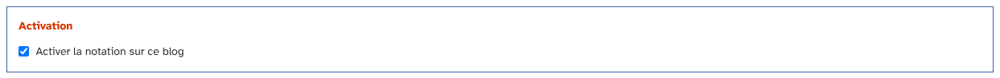

## Choisir le style de notation

Trois styles sont proposés dans la partie *Notation* :

* **Classique** : le visiteur donne une note avec des étoiles.
* **Double** : le visiteur dit s'il aime ou non.
* **Simple** : le visiteur dit seulement s'il aime.

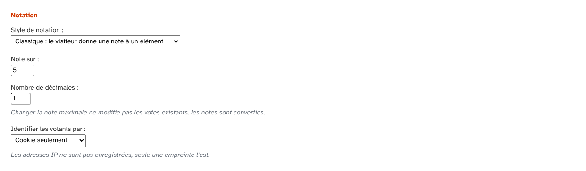

Voici le style classique sur un billet :

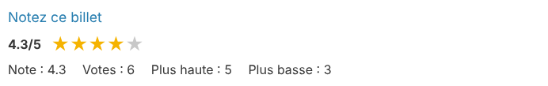

Le style double, avec ses deux boutons :

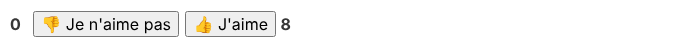

Le style simple, avec un seul bouton :

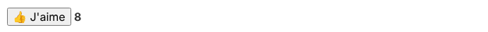

## Régler la note et les messages

Dans la partie *Notation* :

* *Note sur* : la note maximale, de 2 à 20. Par défaut, 5.
* *Nombre de décimales* : de 0 à 4. Par défaut, 1.
* *Identifier les votants par* : l'adresse IP, l'adresse IP et un cookie, ou un cookie seulement.

Changer la note maximale ne supprime pas les votes déjà reçus : ils sont convertis. Par exemple, une note de 4 sur 5 devient 8 sur 10.

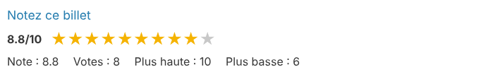

Les adresses IP ne sont pas enregistrées. Seule une empreinte l'est.

La partie *Messages* permet de changer le texte du bouton « j'aime », celui du bouton « je n'aime pas » et le message de remerciement. Laissez un champ vide pour garder le texte par défaut.

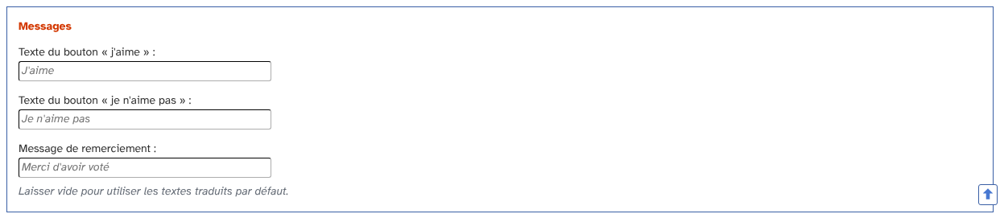

La partie *Partie publique* permet de désactiver le CSS public ou le javascript public. Sans javascript, la page est rechargée à chaque vote.

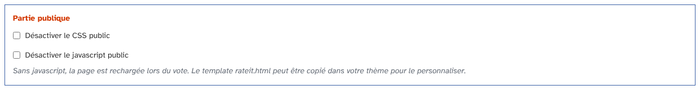

## Choisir ce qui peut être noté

Dans la partie *Modules*, cochez les types d'éléments que les visiteurs peuvent noter. Seuls les types disponibles sont listés : les événements et les liens n'apparaissent que si leur extension est installée.

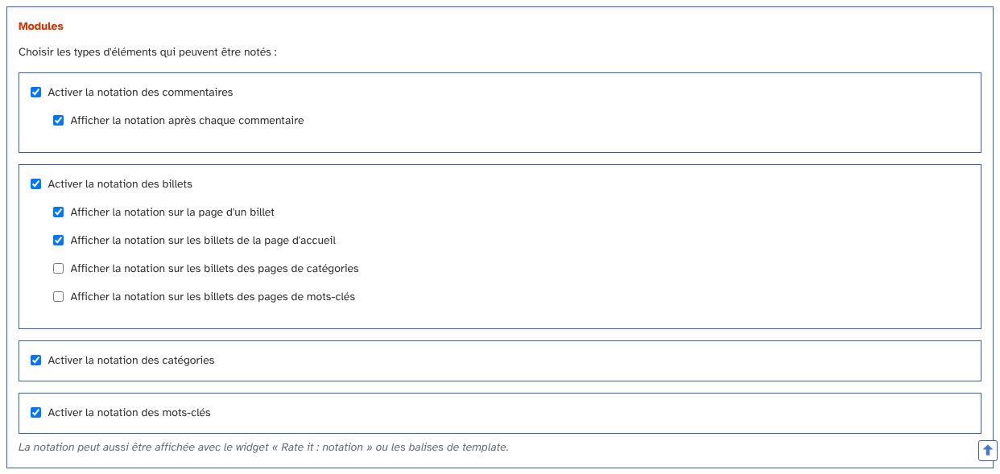

Chaque type a ses options. Pour les billets, vous choisissez où afficher la notation :

* sur la page d'un billet ;
* sur les billets de la page d'accueil ;
* sur les billets des pages de catégories ;
* sur les billets des pages de mots-clés.

Pour les commentaires, *Afficher la notation après chaque commentaire* ajoute la notation sous chaque commentaire.

## Ce que voient les visiteurs

La notation est affichée sous le contenu d'un billet, avec la note, le nombre de votes, la note la plus haute et la plus basse.

Le visiteur clique sur une étoile pour voter. Le vote est pris en compte sans recharger la page.

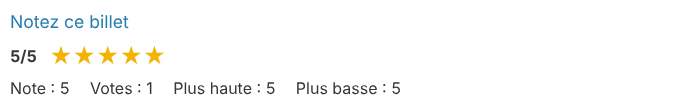

Après le vote, la note est mise à jour et un message de remerciement s'affiche.

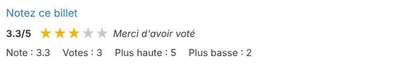

Un visiteur ne peut voter qu'une seule fois par élément. Quand il revient sur la page, les étoiles sont grisées et il ne peut plus changer son vote.

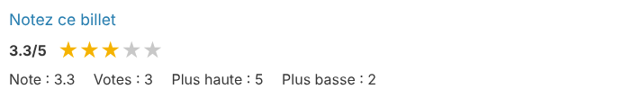

Les commentaires peuvent être notés de la même façon :

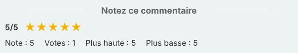

## Les widgets

Deux widgets sont disponibles dans la page *Widgets* de l'administration.

### Rate it : notation

Il affiche le formulaire de vote de l'élément de la page affichée. Vous choisissez ce qu'il montre : la note à côté du formulaire, la note, le nombre de votes, la note la plus haute et la plus basse.

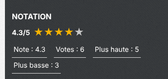

### Rate it : meilleures notes

Il affiche la liste des éléments les mieux notés. Vous réglez :

* le type d'élément ;
* le nombre d'éléments ;
* l'ordre : par note, par nombre de votes, par date ou par votes positifs ;
* le sens du tri ;
* le texte de chaque ligne, avec les jokers `%rank%`, `%title%`, `%note%`, `%quotient%`, `%percent%`, `%count%` et `%totaltext%` ;
* la longueur maximale des titres.

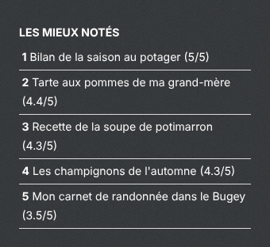

## Personnaliser l'affichage

L'affichage de la notation vient du template `rateit.html`. Copiez-le dans votre thème pour le modifier.

Dans un template, vous pouvez aussi utiliser les balises de rateIt :

* `<tpl:rateIt type="post" style="classic">` : bloc de notation de l'élément courant (les attributs sont facultatifs) ;
* `<tpl:rateItIf has_vote="1" user_voted="0" type="post" style="!twin">` : conditions ;
* `{{tpl:rateItTitle}}`, `{{tpl:rateItLinker}}`, `{{tpl:rateItAnchor}}` ;
* `{{tpl:rateItNote}}`, `{{tpl:rateItFullnote}}`, `{{tpl:rateItQuotient}}`, `{{tpl:rateItMax}}`, `{{tpl:rateItMin}}` ;
* `{{tpl:rateItTotal totaltext="1" none="aucun vote" one="un vote" more="%d votes"}}`, `{{tpl:rateItMaxCount}}`, `{{tpl:rateItMinCount}}`.

## Consulter et supprimer les votes

La page de rateIt dans le menu *Extensions* liste les éléments qui ont reçu au moins un vote. Le texte au-dessus indique le nombre total de votes du blog.

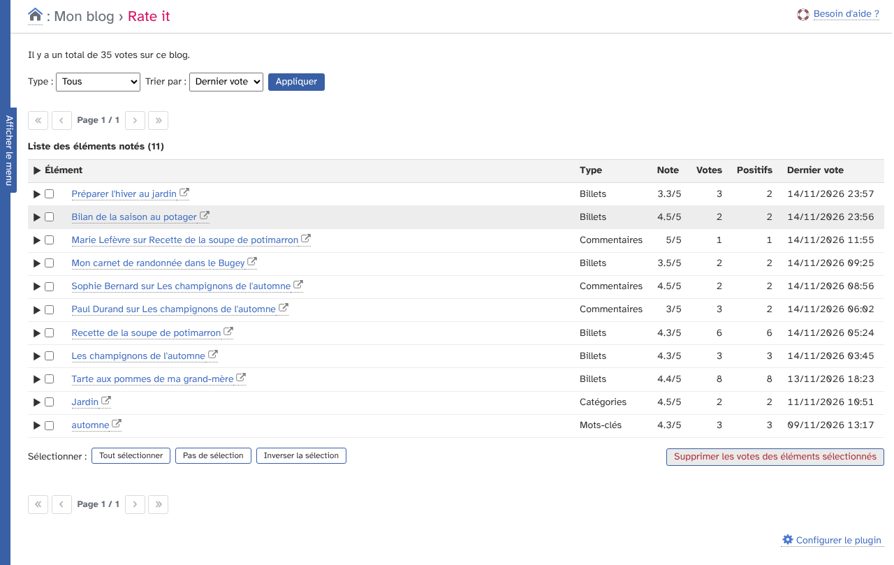

Utilisez les listes *Type* et *Trier par* puis *Appliquer* pour filtrer. Par exemple, pour ne voir que les commentaires, triés par note :

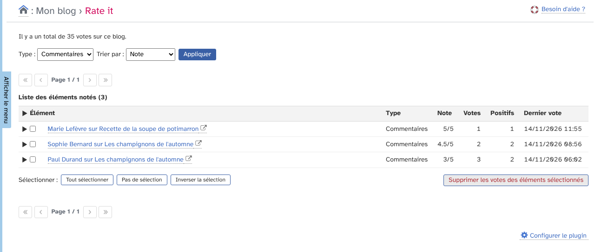

La colonne *Positifs* compte les votes qui valent au moins la moitié de la note maximale.

Cliquez sur le nom d'un élément pour voir son détail. L'icône à côté du nom ouvre l'élément pour le modifier.

Le détail donne la note, le nombre de votes, la note la plus haute et la plus basse. En dessous, chaque vote est listé avec son votant, sa note et sa date.

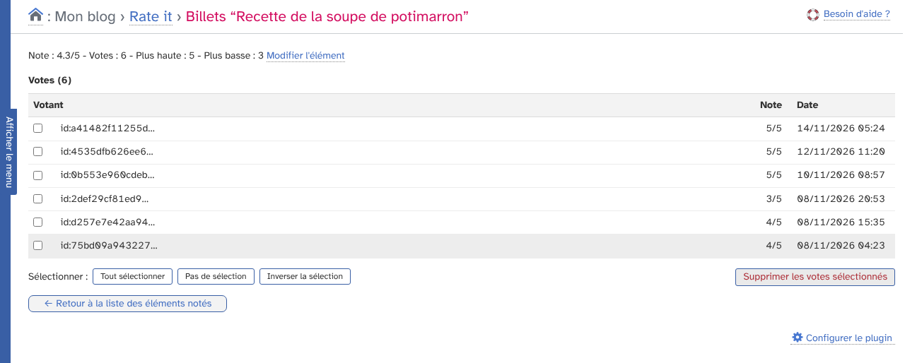

Les votants ne sont pas identifiés par leur nom : seule une empreinte de leur adresse IP ou de leur cookie est affichée.

Pour supprimer :

* tous les votes de plusieurs éléments : cochez-les dans la liste, puis cliquez sur *Supprimer les votes des éléments sélectionnés* ;
* seulement certains votes : cochez-les dans le détail, puis cliquez sur *Supprimer les votes sélectionnés*.

La suppression est immédiate et ne peut pas être annulée.

## Avec un assistant IA

Avec le plugin [ClaudetteMcp](https://github.com/JcDenis/ClaudetteMcp), un assistant IA connecté au blog peut consulter les notes
avec l'outil `list_ratings`, si vous êtes administrateur de contenu : les éléments notés (billets, commentaires, catégories…)
avec leur note moyenne et leur nombre de votes, par exemple pour savoir quels billets plaisent le plus.

L'assistant ne fait que lire : il ne vote pas et ne supprime pas de vote, et les votants ne lui sont jamais identifiés.
_ClaudetteMcp_ n'est pas nécessaire au fonctionnement de _rateIt_.

## À savoir

* La page de rateIt demande les droits d'administrateur de contenu. Sa configuration demande les droits de super administrateur.
* Un visiteur qui change de navigateur ou d'adresse IP peut voter de nouveau, selon le mode d'identification choisi.
* Si vous modifiez la note maximale, les notes déjà données sont converties, pas supprimées.
